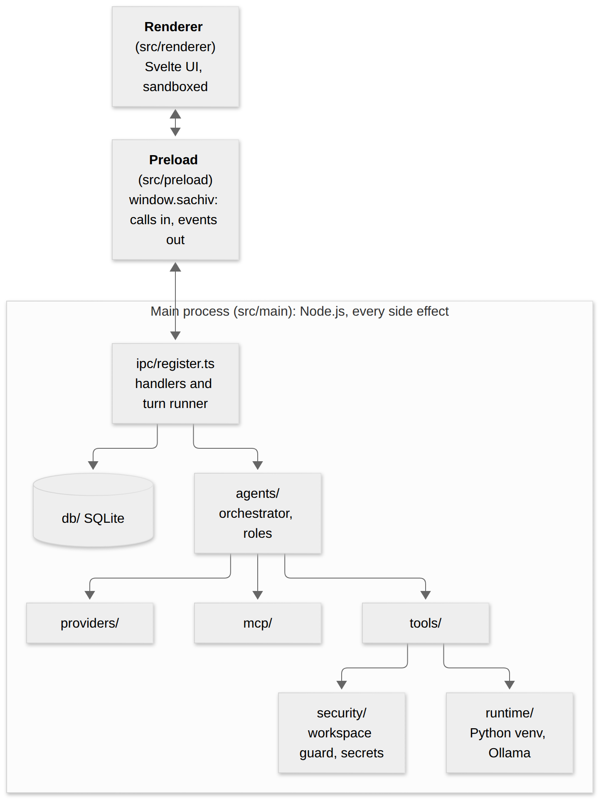
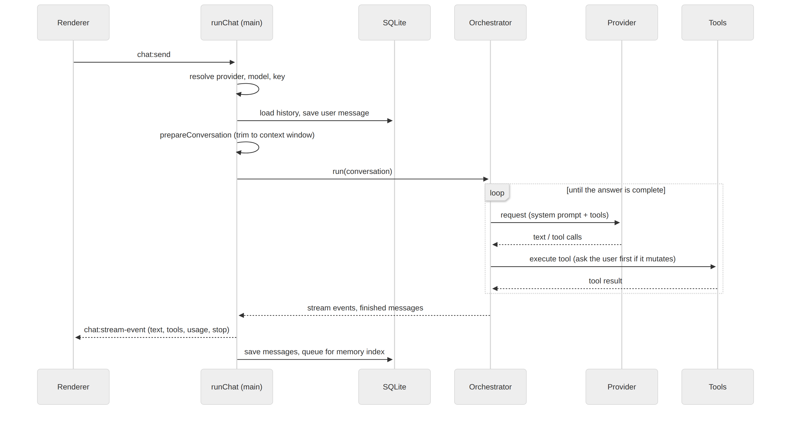
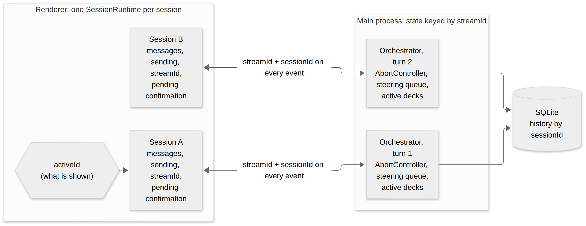
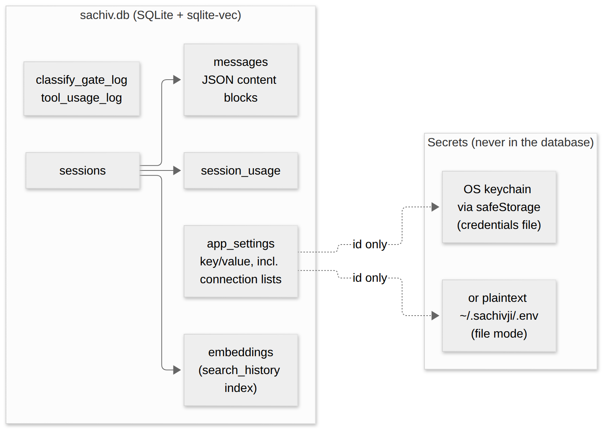

# 3. Architecture

## Processes

| Part | Where | Notes |
|---|---|---|
| **Main process** | `src/main` | Node.js. Owns every side effect: database, secrets, providers, tools, agents, MCP, runtimes. |
| **Preload** | `src/preload/index.ts` | Sandboxed. Exposes one typed object, `window.sachiv`, through `contextBridge`. Built as CommonJS (sandboxed preloads cannot use ES modules). |
| **Renderer** | `src/renderer` | Svelte UI. `nodeIntegration` off, `contextIsolation` and `sandbox` on: it can only call what `window.sachiv` offers. |

`src/shared` holds the types all three import, so the compiler checks the contract. A hidden second page, `print.html`, renders a transcript for PDF export (`sessions/export.ts` calls `printToPDF()` on it); its Content-Security-Policy is separate and must allow what it renders (for example `img-src data:`).

## Start-up (`src/main/index.ts`)

1. `app.setName('Sachivji')` fixes the user-data folder name.
   Then `ensureSingleInstance` (`single-instance.ts`, TASKS #131) asks Electron for the single-instance lock (keyed by the user-data folder, so a copy started with its own `--user-data-dir` is not blocked). A second launch shows an error box once the app is ready, quits when it is dismissed, and creates no window, database or handlers; the first instance restores and focuses its window.
2. On `whenReady`: set the database path (`<userData>/sachiv.db`), call `registerIpcHandlers()`, create the window (saved bounds and zoom), start the update check (packaged builds only).
3. `registerIpcHandlers()` (`ipc/register.ts`) builds the tool context, registers every handler and starts, without blocking, the Python runtime, the bundled Ollama, the MCP connections, the saved-query tools and the search-history backfill. Their progress reaches the UI as state events (`RuntimeStateChanged`, `OllamaStateChanged`).

## The IPC contract

Every call across the boundary touches three files, kept in step:

1. `src/shared/ipc-contract.ts`: the `IpcChannel` constants (`sessions:list`, `chat:send`, ...) and each payload's DTO type.
2. `src/preload/index.ts`: one typed function per channel on `window.sachiv` (`ipcRenderer.invoke` for request/response, `ipcRenderer.on` for pushed events).
3. `src/main/ipc/register.ts`: `ipcMain.handle(IpcChannel.X, ...)`.

To add a channel, see the [extension checklists](appendix-extension-checklists.md).

**Streaming.** `chat:send` starts a turn and returns a `streamId`. Main then pushes `chat:stream-event` messages, each carrying a `StreamEvent` (`src/shared/protocol.ts`: `text_delta`, `thinking_delta`, `tool_use_*`, `tool_result`, `image`, `plan*`, `status`, `warning`, `usage`, `context_window`, `user_note`, `error`, `message_stop`). The renderer listens per `streamId` and stops at the final stop. Companion channels: `chat:cancel` (aborts via an `AbortSignal` passed all the way down), `chat:steer` (a mid-run note), `tools:confirm-request/respond` (the human confirmation, an awaited promise) and `limit:reached-request/respond` (the "continue or stop" question).

## One chat turn

`runChat` (`ipc/register.ts`) runs it:

1. **Resolve** provider, model and key from settings and the secret store; fail early with a clear message.
2. **Prepare.** `refreshRoles()` re-reads user roles. `prepareConversation` (`context/prepare-context.ts`) trims oversized tool results and drops the oldest turns to fit the context window, for what is *sent*, never what is stored.
3. **Persist** the user message, and set the title on the first exchange.
4. **Run** the orchestrator (`orchestrator.run(conversation, forcedRole)`) and forward its `stream` events; add `usage` to the session totals; persist `message` events and queue them for the memory index.
5. **Clean up.** The final stop is held until the run ends, and any unsaved in-progress presentation is saved.

The orchestrator is covered in [Orchestrator and agents](04-orchestrator-and-agents.md).

## Switching sessions and concurrent turns

The orchestrator knows nothing about sessions. `runChat` builds a **new** `Orchestrator` for every turn and gives it the history it loaded for that `sessionId`; when the turn ends it is gone. Everything that lives while a turn runs is keyed by the turn's `streamId` in `ipc/register.ts`: the `AbortController` (`activeStreams`), the steering queue (`pendingSteeringComments`) and the turn's `activeDecks`. Every pushed event carries both `streamId` and `sessionId`, and a confirmation or "continue or stop" request carries the `sessionId` (and the `toolUseId` the answer comes back on).

Switching sessions is therefore **purely a renderer matter**; main is never told.

- The renderer keeps one `SessionRuntime` per session (`App.svelte`): its messages, token totals, `sending`, `currentStreamId`, and any pending confirmation or limit question. `activeId` only chooses which one is shown.
- The listener each send registers closes over its own session's runtime, so a stream keeps filling its session while you look at another. (Earlier, one global `sending` and message array made a switched-away session look permanently busy and threw on every later event; this is the fix.)
- A session loads from the database once. After that its live runtime is the source of truth, so switching back shows what arrived in the meantime instead of a stale reload.
- Several sessions can generate at once. A confirmation from a session you are not viewing waits in that session's runtime (the sidebar shows an activity dot) rather than opening a dialog over your current work. Auto-approve rules still apply to it. The rules are stored as `autoApproveToolRules` (tool name to boolean); the gate is `shouldAutoApprove` (`renderer/src/lib/auto-approve.ts`), which never approves `external_folder_access`. `ToolsList` returns each mutating tool with a `source` (`tools/tool-source.ts`: Built-in, Saved query, or MCP server: name), and Settings lists stored rules that name no current tool (`staleRuleNames`) so they can be removed; nothing deletes a rule silently, since a disconnected MCP server's tools return when it reconnects.
- Stop and steering act on the *shown* session's `currentStreamId` only.

Limits: main does not check whether a session already has a turn running (the renderer's `sendMessage` returns early while that session's `sending` is true), and concurrent turns share one SQLite connection and one workspace, so two turns can touch the same files.

## Persistence

One SQLite file opened with `better-sqlite3` plus `sqlite-vec` (`db/index.ts`). `db/schema.sql` is applied idempotently at start-up, with small in-code migrations for added columns. Foreign keys cascade from `sessions`, so deleting a chat deletes its messages, usage and embedding bookkeeping. The vector table is a virtual table and is not reached by cascades, so `deleteSession` removes its rows explicitly. The memory design is in [Memory and search history](13-memory-and-search-history.md).

- `messages.content` is a JSON `ContentBlock[]` (`text`, `thinking`, `tool_use`, `tool_result`, `image`, `warning`, `user_note`). A tool result that continues a turn is stored as a `user` message holding only `tool_result`/`image` blocks; transcript rendering and export treat it as a continuation, not a new turn.
- `app_settings` is a key/value store for every setting, including the JSON lists of data, API, email and MCP connections.
- **Secrets are never in the database.** `security/keychain.ts` stores them with Electron's `safeStorage` (OS keychain/DPAPI/libsecret) in a credentials file, or, in file mode, in plaintext `~/.sachivji/.env`. Settings hold only the connection data; its secret is keyed by prefix (`db:<id>`).

## Other cross-cutting pieces

- **Workspace guard** (`security/workspace-guard.ts`): real-path checks confining file tools to the workspace; outside access goes through `security/external-access.ts` (user-approved, read-only).
- **Runtimes** (`runtime/`): managed Python venv and bundled Ollama, each a state machine the UI observes.
- **Settings export/import** (`settings/`): configuration only, never secrets.
- **Window helpers** (`window/`), **updater** (`updater.ts`): remembered bounds and zoom, spell-check menu; GitHub Releases check on start, never a silent install.
