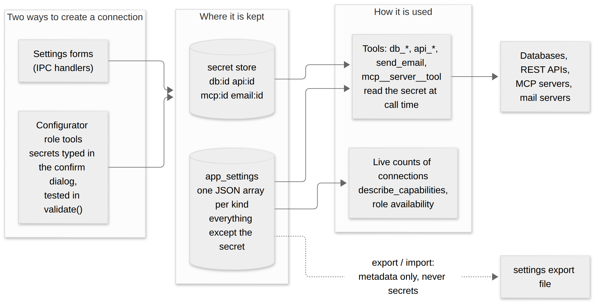
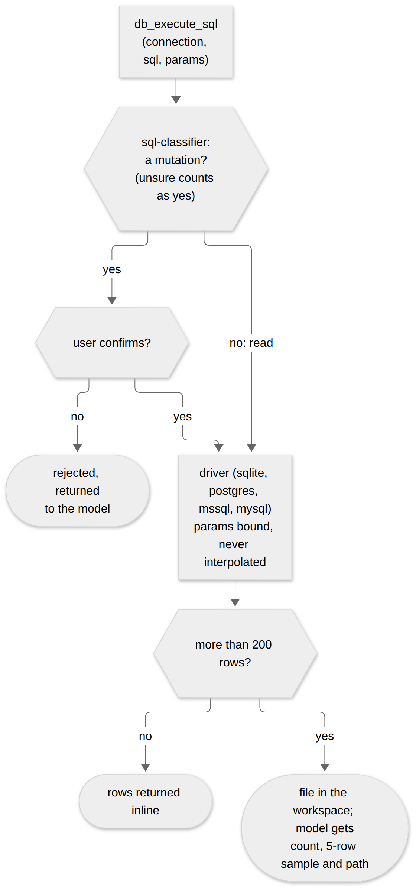
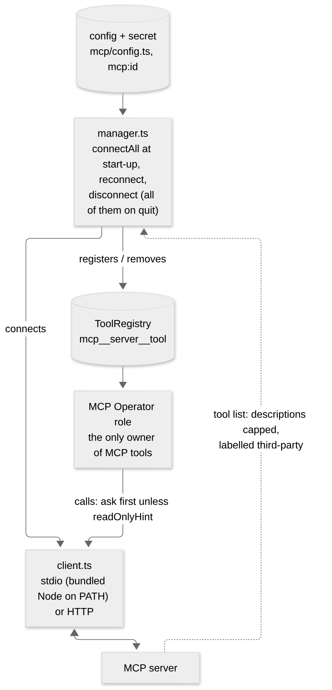
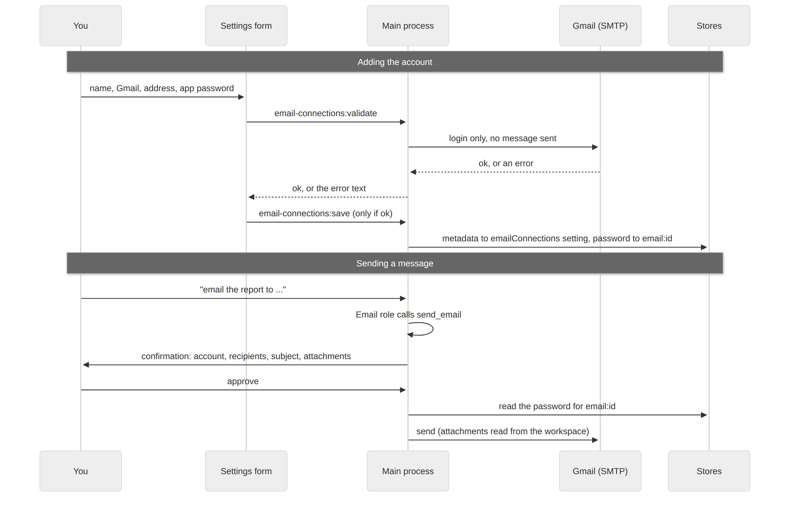

# 7. Data, APIs, MCP and email

Four kinds of **connection** let the agents reach outside the app: databases, external REST APIs, MCP servers and email accounts. They share one storage pattern, and each has a store (`src/main/data`, `src/main/mcp`), tools (`src/main/tools`) and a Settings section.

## The common pattern



- **Metadata** (everything except the secret) is one **JSON array under a single settings key** in the `app_settings` table, read and written through the stores: `data/connections.ts` (databases), `data/api-connections.ts`, `data/email-connections.ts`, `mcp/config.ts`.
- The **secret** (a database password, an API key, a bearer token, an app password) goes through the secret store (`security/keychain.ts`) under a prefixed key: `db:<id>`, `api:<id>`, `mcp:<id>`, `email:<id>`. It is looked up fresh when needed and **never persisted together with the metadata**.
- A connection has a generated `id`, a user-chosen `name` (what the user and the model call it), and engine- or type-specific fields.
- **Settings export/import** (`settings/import-export.ts`) copies the metadata and, for a database connection, its saved queries, never the secrets. Import skips an item whose name already exists.
- Connections are created two ways, both ending in the same store function: the Settings forms (IPC handlers in `register.ts`) or the **Configurator** role's tools (`tools/config-gen`), which collect secrets through the confirmation dialog (`secretFields`) and test the connection in `validate` before anything is saved.
- `describe_capabilities` and the role availability checks read live **counts** of connections (`getConfiguration` in `runChat`), so a role such as Data Access is reported unavailable until a connection exists.

## Databases

**Drivers** (`tools/db/`). A driver implements `DbDriver`: `engine`, `introspectSchema()`, `execute(sql, params?)` and `close()`. `driver-factory.ts` builds one from a saved connection: `sqlite-driver.ts` (`better-sqlite3`), `postgres-driver.ts` (`pg`), `mssql-driver.ts` (`mssql`), `mysql-driver.ts` (`mysql2`). Parameters are always bound positionally (`?` or `$1..$n`), never interpolated into the SQL.

**Tools:** `db_list_connections`, `db_introspect_schema`, `db_execute_sql`, `db_list_rows`, `db_count_rows`, `db_find_rows` (`crud.ts`: mechanical lookups with validated identifiers, `identifier.ts`), and `db_save_query`.



**Is this SQL a mutation?** `db_execute_sql` declares `mutates` as a function of the SQL, using `sql-classifier.ts`. It is deliberately conservative and defaults to "mutating" when unsure. It catches writable CTEs (`WITH x AS (DELETE ... RETURNING *)`) and statement stacking (`SELECT 1; DROP TABLE users`), which a leading-keyword check would miss. A read runs freely; anything else asks for confirmation.

**Large results never become context.** `formatQueryResult` returns a result of up to `DISPLAY_ROW_LIMIT` (200) rows inline; a larger one is written to a workspace file and only an honest summary (real count, a 5-row sample, the path) is returned. This keeps big data out of stored messages, the conversation re-sent each round and the memory index. A later step (the Developer) reads the file.

**Saved queries.** `db_save_query` stores a working parametric query inside its connection's own `savedQueries` array (so deleting the connection removes them) and **registers it as its own tool** in the live registry through `saved-query-manager.ts` (`register`, `syncAll` at start-up). The tool name has a random suffix so two queries with the same readable name can never collide. Parameters bind through `param-binding.ts`.

**Schema summaries** (`schema-summary.ts`) give `db_list_connections` a small table-name hint so the model can pick the right connection.

## External REST APIs

- **Store:** `api-connections.ts`. A connection has `baseUrl`, `authType` (`none`, `apiKey`, `bearer`, `basic`), for an API key the placement (`apiKeyIn`: header or query) and its name, a username for basic auth, and an optional `specUrl`.
- **Client** (`tools/api/client.ts`): builds the request, applying auth from the secret looked up at call time.
- **Tools:** `api_list_connections`, `api_introspect` (fetches an OpenAPI/Swagger spec, the connection's own `specUrl` or a handful of conventional locations, and summarises endpoints), `api_call`, `api_check_status`.
- **`api_call`** declares `mutates` per call (a method other than a safe read asks first). It can **follow pagination** when asked (`pagination.ts`: RFC 5988 `Link` headers and a set of common "next page" JSON fields) and tells the model what it did.
- **`api_check_status`** polls an asynchronous job (a 202 response or a job-style body with a pending status) instead of blocking the chat turn.

## MCP servers



- **Config** (`mcp/config.ts`): metadata `{ id, name, transport, command?, args?, env?, url?, description? }`. The bearer token (HTTP only) is in the secret store as `mcp:<id>`. The user-written one-line `description` is capped (`MCP_SERVER_DESCRIPTION_MAX`, 200 in the UI).
- **Client** (`mcp/client.ts`): built on `@modelcontextprotocol/sdk`. `buildTransport` creates a `StdioClientTransport` (a local program) or a `StreamableHTTPClientTransport` (a remote server). For stdio, the bundled Node directory is **prepended to `PATH`**, so a bare `npx`, `npm` or `node` command resolves to the Node that ships with the installer (a clean machine has none; most MCP servers launch through `npx`).
- **Manager** (`mcp/manager.ts`): owns live state. `connectAll`, `reconnect`, `disconnect`, `disconnectAll` and `getStatus`. It registers each discovered tool in the **same `ToolRegistry`** as the built-ins, named `mcp__<server>__<tool>`, with `tool.mcp = { server, serverDescription }`, and remembers which registry entries belong to which server so they can be removed on reconnect or delete. `connectAll` runs at start-up without blocking; `before-quit` disconnects every server so stdio children are not orphaned.
- **Ownership:** MCP tools belong to the **MCP Operator** role alone; the role's prompt is a live getter that lists the connected servers with the user's descriptions, so a server with many tools costs nothing for other requests.
- **Untrusted text.** A server's tool descriptions are capped (`MCP_TOOL_DESCRIPTION_MAX`, 400) and wrapped with a label saying they are third-party metadata, not instructions. Server-authored handshake instructions are not injected anywhere. `scripts/manual-test-mcp-server.mjs` is a test server with a deliberately hostile description for checking this.
- **Mutation:** an MCP tool is treated as mutating **unless the server annotates it `readOnlyHint: true`** (`mutates: mcpTool.annotations?.readOnlyHint !== true` in `mcp/client.ts`), so by default every MCP call asks for confirmation and a server has to opt in to being read-only.

## Email

- **Store:** `email-connections.ts`. `provider` is `gmail` (nodemailer's `service: 'gmail'` preset, with an app password) or `custom` (a plain SMTP `{ host, port, secure }`). One connection can be the **default**, held in a single separate setting so changing the default is a one-key write. A connection saved before `provider` existed reads back as Gmail.
- **Transport** (`tools/email/transport.ts`): builds the nodemailer transporter.
- **Tools:** `list_email_connections` and `send_email` (`mutates: true`: the confirmation names the actual sending account, recipients, subject and attachments). Attachments are workspace-relative paths.
- **Role:** the Email specialist is `isolated` with a small round budget: a fully specified send needs only the brief it is given.

### Worked example: configuring Gmail



Gmail is the supported account type. The app signs in with an **app password** (a 16-character password Google generates for one app), not the account's normal password.

**1. Prepare the Google account.**
- Turn on 2-Step Verification: <https://myaccount.google.com/signinoptions/two-step-verification> (help: <https://support.google.com/accounts/answer/185839>).
- Create the app password: <https://myaccount.google.com/apppasswords> (help: <https://support.google.com/accounts/answer/185833>). Google shows it once, in four groups of four letters.
- Per Google's help page, the option may be missing when 2-Step Verification uses security keys only, for a work, school or other organisation account, or under Advanced Protection; those accounts cannot be used. Changing the Google account password revokes every app password. Google also calls app passwords "not recommended" where "Sign in with Google" (OAuth) is available, which this app does not implement.
- The links were checked on 2026-10-16. They belong to Google, who can change or remove them at any time, so treat them as pointers, not permanent addresses.

**2. Add the account in the app.** Open **Settings > Email accounts** and click **+ Add email account**:

| Field | What to enter |
|---|---|
| Display name | Any name you will recognise, for example `Work Gmail`. The assistant addresses the account by this name. |
| Provider | **Gmail** |
| Email address | The full Gmail address. |
| Password / app password | The app password from step 1. |

Click **Add account**. The button reads "Signing in..." while the app makes a **real login to Gmail without sending a message** (`verifyEmailConnection`, nodemailer's `transport.verify()`). If the login fails, the form shows Google's own error text and **nothing is saved**. If it works, the account is saved.

**3. What gets stored.** The metadata goes into the `emailConnections` setting. The password goes into the secret store under `email:<id>`, never into the database:

```json
{ "id": "7f0c…", "name": "Work Gmail", "emailAddress": "you@gmail.com", "provider": "gmail", "hasSecret": true }
```

`host`, `port` and `secure` are stored only for a `custom` account. For Gmail the transport is just `nodemailer.createTransport({ service: 'gmail', auth })`; nodemailer supplies the host, port and TLS.

**4. Default account.** With exactly one account, it is the default automatically. With two or more, click **Set as default** next to one in the list, otherwise `send_email` needs the account named (the assistant then calls `list_email_connections` and asks).

**5. Try it.** In a chat, ask: "Send a test email to myself saying hello." The Email specialist calls `send_email`. A confirmation panel shows the sending account, the recipients, the subject and any attachments before anything is sent. Approve it, and the message goes out through Gmail. Attachments must be files inside the workspace.

**If it fails**

| What you see | Likely cause |
|---|---|
| A login error mentioning an *application-specific password* | The normal account password was entered, or 2-Step Verification is off. Create an app password. |
| It worked, then every send fails with a login error | The Google account password was changed, which revokes all app passwords. Create a new one and edit the account. |
| "Username and Password not accepted" | A typo, a revoked app password, or an account where app passwords are disabled. Create a new app password and try pasting it without the spaces. |
| The send works but nothing arrives | Check the recipient's spam folder and the account's Sent folder. The app only confirms that Gmail accepted the message. |

These error texts are Google's, passed through by nodemailer, so the exact wording can change.

**Not Gmail.** There is deliberately no Outlook or Microsoft 365 option: Microsoft has retired SMTP password sign-in for those accounts (`tools/email/transport.ts` records the live test), and a real option needs OAuth sign-in, which is not built yet (TASKS #79). A **Custom SMTP server** (host, port, "TLS on connect") works for a provider that accepts a plain user name and password, but only Gmail is in the tested set.

## Adding another connection type

Follow the pattern: a store with metadata in one settings key and a prefixed secret; Settings IPC handlers and a Settings section; tools (reads free, writes `mutates`); a Configurator tool if it should be creatable from chat; a role owner; an entry in `describe_capabilities` and the configuration counts; and settings export/import support. See the [extension checklists](appendix-extension-checklists.md).
