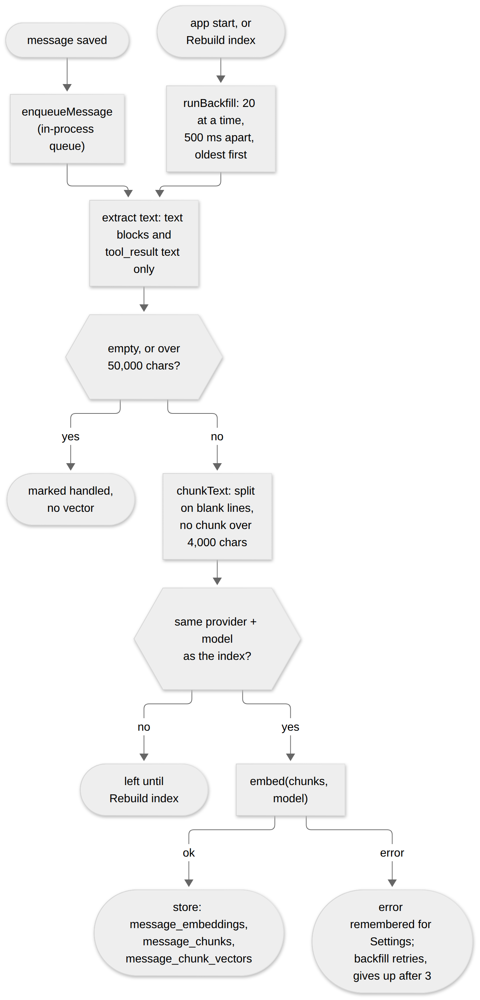
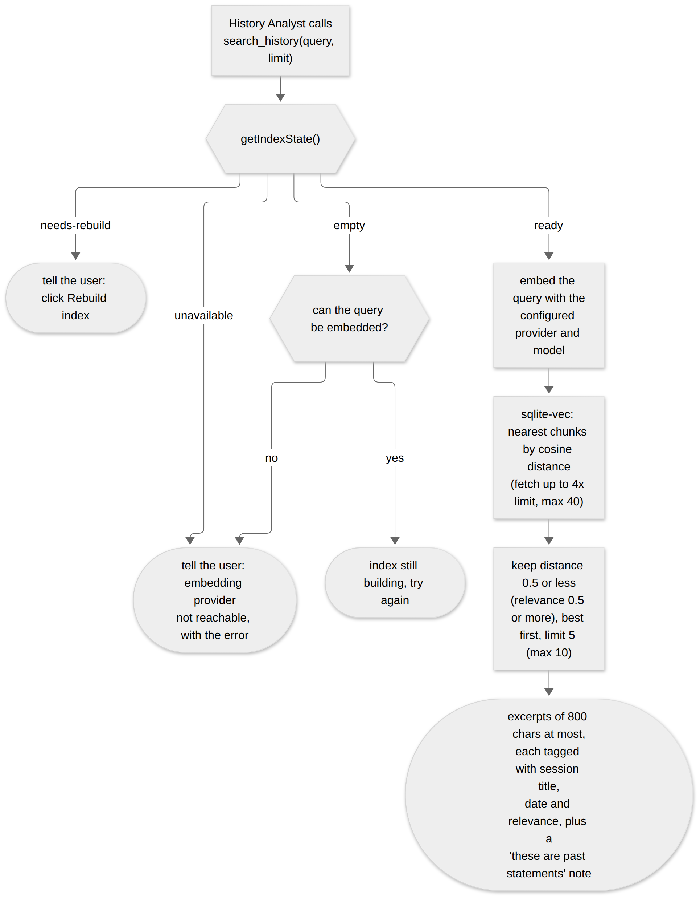

# 13. Memory and search history

The app can recall what was said in earlier conversations. Every message is turned into vectors (**embeddings**) in the background, and the **History Analyst** role searches them with the `search_history` tool. The code is in `src/main/search-history/`: `indexer.ts` (index, queue, backfill, search), `chunk-text.ts`, `extract-text.ts` and `tool.ts`. The user-facing description is in the User Guide page [Memory across chats](../user-guide/07-memory-across-chats.md).

## Why it is built this way

- **The agent decides, not the app.** Context trimming drops the oldest turns of a long chat from what is *sent* to the model. Instead of guessing what to bring back, the model calls `search_history` when it needs something. Nothing is injected silently (TASKS #52).
- **The embedding model is separate from the chat model.** Whichever provider answers the chat has no bearing on the index. The same embedding model must be used to index and to query: vectors from different models cannot be compared, and mixing them silently corrupts results. So the index records the model it was built with, and a change forces a rebuild (below).
- **Local by default.** The default is `nomic-embed-text` on Ollama (the bundled server, see [Runtime and bundling](08-runtime-and-bundling.md)), so history never leaves the machine unless the user picks a cloud embedding provider.
- **Search at chunk level.** A reply that covers two topics must not come back whole for a query about one of them, so each message is split into paragraph-sized chunks and each chunk has its own vector.

## Data model

All of it is in `sachiv.db` (see [Architecture](03-architecture.md#persistence)).

| Table | Content |
|---|---|
| `embedding_index_meta` | One row (`id = 1`): the `provider_id`, `model` and vector `dimension` the index was built with. |
| `message_embeddings` | Bookkeeping only: one row per message that has been *handled* (embedded, or deliberately skipped). `message_id` is unique. |
| `message_chunks` | One row per chunk: `message_id`, `session_id`, `chunk_text`. Its `id` is the rowid of the matching vector. |
| `message_chunk_vectors` | A `sqlite-vec` `vec0` virtual table, `embedding float[<dimension>] distance_metric=cosine`, keyed by the chunk id. |

Two details matter:

- **The vector table is created lazily.** Its dimension is not known until an embedding model has actually run once, so `schema.sql` cannot declare it. `embedAndStoreChunks` creates it (`CREATE VIRTUAL TABLE IF NOT EXISTS`) and writes the `embedding_index_meta` row on the very first embed.
- **Cascades do not reach the vector table.** Foreign keys delete a chat's messages, `message_embeddings` rows and `message_chunks` rows, but not rows in a virtual table. `deleteSession` (`db/sessions.ts`) therefore deletes the matching `message_chunk_vectors` rows itself, in the same transaction.

## Indexing

**What is indexed** (`extractSearchableText`): the text of `text` blocks and of `tool_result` blocks (so a query result or a fetched page is searchable too). `tool_use` blocks, thinking, images, warnings and steering notes are not. The output of `search_history` itself is skipped, recognised by its own wrapper tags and diagnostic prefixes. Otherwise a recalled excerpt would be indexed again as new content and every recall would spread unrelated text further (a bug found live).

**Two ways in, one path.**
- **Live:** after each message is saved, `runChat` calls `enqueueMessage`. Jobs run one at a time from a plain in-process array, never block the chat reply, and a failure is only logged and remembered.
- **Backfill:** `runBackfill` runs at start-up and from **Rebuild index**. It selects messages with no `message_embeddings` row, oldest first, 20 per batch with a 500 ms pause, until none are left. This is how old chats are caught up, and how a message whose live job failed gets a second chance.

**Chunking** (`chunkText`): split on blank lines; drop pieces under 20 characters unless that would leave nothing (a short message such as "OK." is kept); then hard-split any piece over **4,000 characters**. The cap exists because a 30 KB single-paragraph blob once exceeded the embedding model's context and crashed the Ollama server (TASKS #171).

**Skipped, not failed.** A message with no searchable text, or over **50,000 characters** (a multi-megabyte query result has no prose to match and would mean thousands of embed calls), gets a `message_embeddings` row with no vectors so it is never selected again.

**Failure handling.**
- The embed call happens *before* any bookkeeping insert, so a thrown error leaves the message un-handled and the next backfill retries it.
- The write is idempotent: `ON CONFLICT(message_id) DO NOTHING` settles a race between a live job and backfill.
- A message that keeps failing is retried up to **3 times** in one run, then marked handled with no vector, so one bad message cannot loop forever. The counter is in memory, so a restart gives it fresh attempts.
- The last error is kept (`lastEmbedFailureReason`) so Settings can show "unavailable" with the reason, instead of looking like an empty index. It clears on the next success.

## Configuration and model changes

Settings keys: `embeddingProviderId` (default `ollama`) and `embeddingModel` (default `nomic-embed-text`), chosen in **Settings > Search History Embedding**. Only providers with `supportsEmbeddings` are offered ([Providers](05-providers.md)). `probeEmbeddingDimension` makes one real embed call so the picker can show a model's true vector size.

`getIndexState()` returns one of four states, reported to the UI as `SearchHistoryStatusDto`:

| State | Meaning |
|---|---|
| `empty` | Nothing indexed yet and no failure recorded. |
| `ready` | The index matches the configured provider and model. Carries `indexed` and `total` message counts. |
| `needs-rebuild` | The configured provider or model differs from `embedding_index_meta`. Indexing and backfill stop, and search refuses, until the user clicks **Rebuild index**. |

**Digest guard (TASKS #224).** `embedding_index_meta` has no digest column (no migration mechanism); the digest of the model's weights when the index was built lives in the `embeddingIndexDigest` setting (empty = unknown). `EmbeddingProvider.modelDigest?()` is optional; `OllamaProvider` implements it from `/api/tags`. `verifyEmbeddingDigest()` runs at start-up, when the bundled Ollama becomes ready, and before indexing a message when the last check is older than 5 minutes. A different digest sets `digestMismatch`: `getIndexState()` returns `needs-rebuild` with `cause: 'model-changed'`, new messages are not added, and search says so. An index with no stored digest adopts the current one (built before #224). Rebuild clears the flag and stores the new digest. `App.svelte` reads `getSearchHistoryStatus` at start and every 15 s and shows a dismissible banner (reusing the update-banner style) when the state is `needs-rebuild` with `cause: 'model-changed'`; dismissal lasts until restart. Not done: pinning the model by digest, because Ollama pulls by name and tag, not by digest.
| `unavailable` | Nothing indexed and the last embed failed (for example Ollama not running, or the model not pulled). Carries the reason. |

**Rebuild index** (`rebuildIndex`) drops `message_chunk_vectors`, deletes every chunk, every `message_embeddings` row and the meta row, then runs a full backfill. It **re-embeds the whole history**, so it can take a long time on a large history, and it costs money if the new provider is a paid cloud one. This is why a model change never rebuilds automatically.

## Searching

Only the **History Analyst** role owns `search_history` (the Researcher and the router do not); a request that needs recall is delegated to it. `searchIndex` embeds the query with the configured model, asks `sqlite-vec` for the nearest chunks by **cosine distance** (it fetches up to 4 times the limit, at most 40), keeps those at distance **0.5 or less**, and returns the best `limit` (default 5, at most 10). Each excerpt is cut to 800 characters and wrapped as `<historical_result session="…" date="…" relevance="…">`, where relevance is `1 - distance`. A closing note reminds the model that excerpts are past statements: anything about configuration or availability may have changed, so it must check live state.

- **The distance floor.** Nearest-neighbour search always returns *something*, however weak. Observed on `nomic-embed-text`, genuine matches scored 0.67 to 0.89 relevance and unrelated chunks 0.42 to 0.48, so 0.5 sits in the gap. **That number is calibrated to the default model.** A different embedding model has a different score distribution and may need a different floor; there is no cross-model standard. Fewer, better results are preferred over a full list padded with noise.
- **The current session is not excluded.** After the sliding window drops early turns, the only way back to them is this tool, so a hit from the running chat is valid. The cost is an occasional duplicate of something already in context.
- **Honest failure messages.** `tool.ts` returns plain text for `needs-rebuild`, `unavailable`, an index still building and an unreachable provider, each telling the model to say so to the user and not guess.

## Known limits

- The floor and the 4,000 / 50,000 character caps are tuned by observation, not derived.
- Search is vector-only: no keyword or exact-phrase match, no date or session filter.
- The failure counter is per process, so a permanently failing message is retried 3 times after every restart.
- A first backfill of a long history on the bundled CPU-only Ollama is slow; it runs in the background and the status shows `indexed / total`.
- Until the embedding model is available (the first-run download, or a provider outage), search reports "unavailable" or "still building" and the History Analyst says so.

## Tests

`indexer.test.ts` (queue, backfill, failure counting, state, search with a fake embedding provider and a real `sqlite-vec` table), `chunk-text.test.ts`, `extract-text.test.ts` and `tool.test.ts` (each message shape). None calls a real embedding service. After changing the indexing or the floor, try a real conversation against the default model, because the floor is only meaningful against real vectors.
