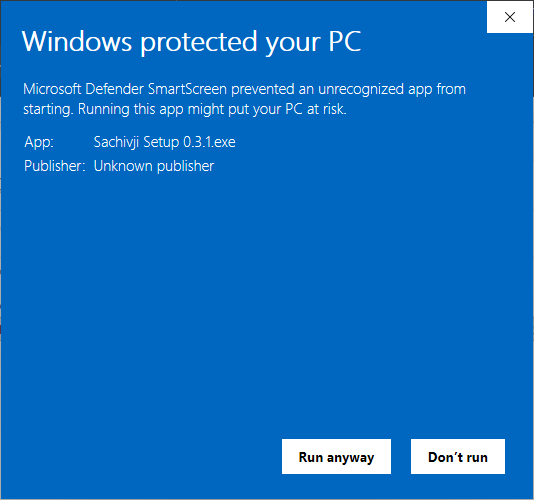
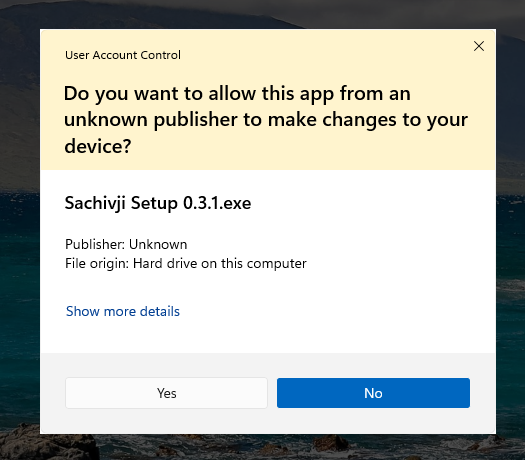
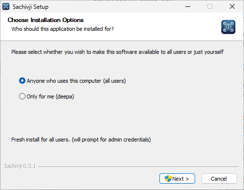
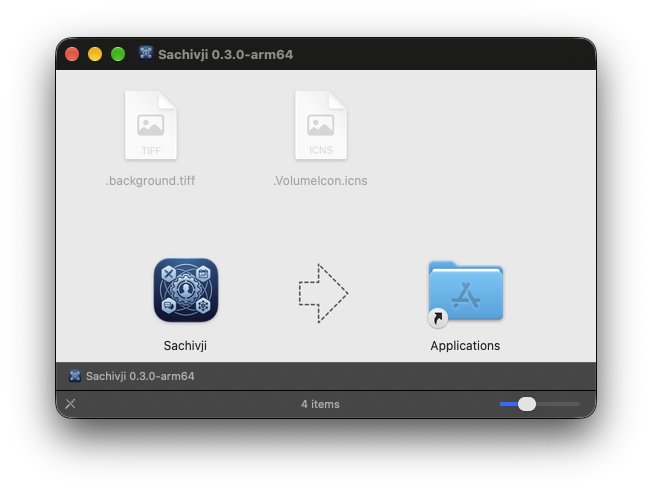
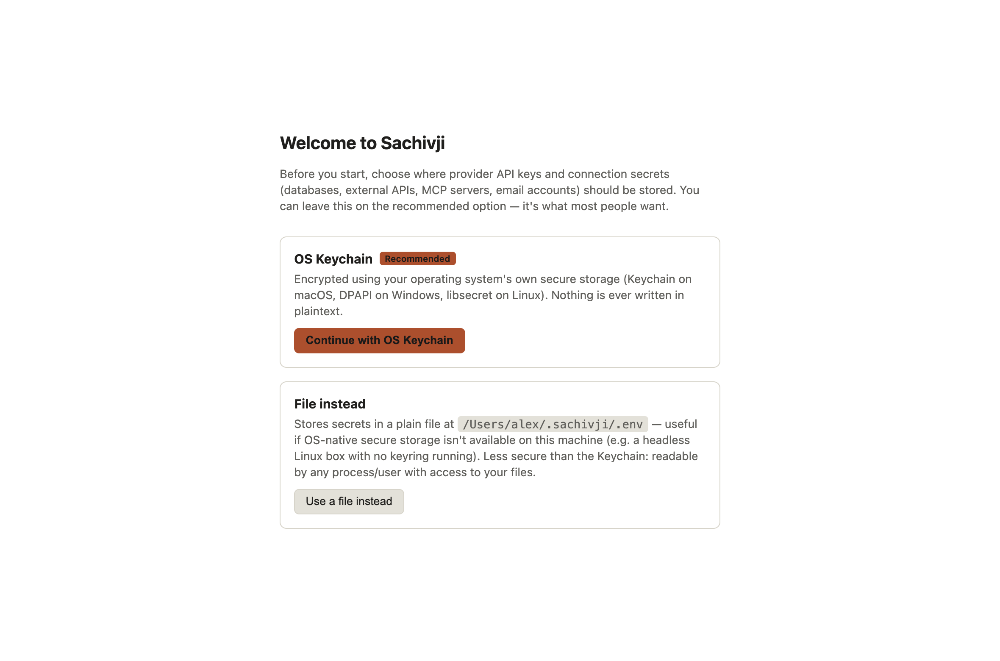
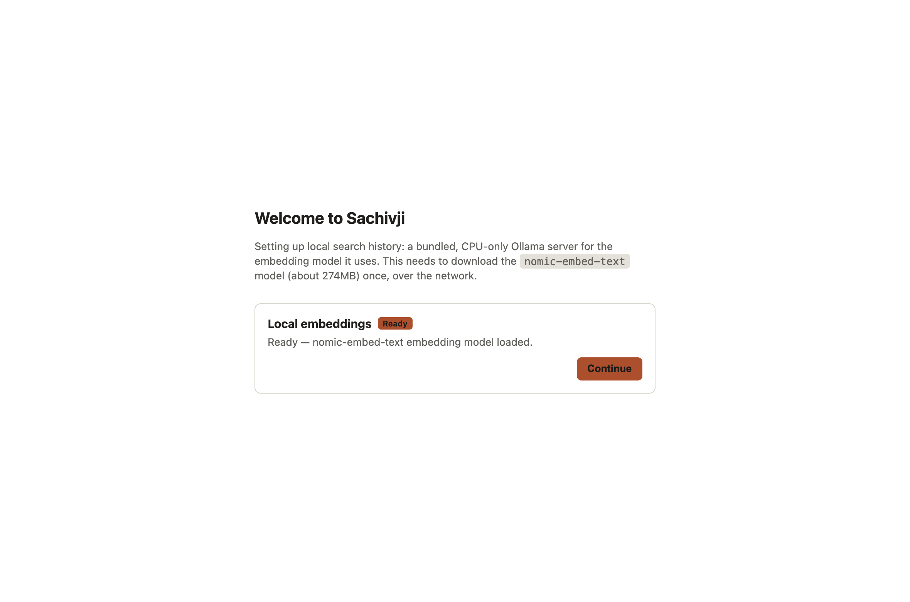

# 2. Install and first run

## Download

Installers are published on the project's **GitHub Releases** page:

| System | File | Notes |
|---|---|---|
| Windows 11 (64-bit) | `Sachivji-Setup-<version>.zip` | A zip holding the installer; extract it first. Standard installer wizard |
| macOS (Apple Silicon) | `Sachivji-<version>-arm64.dmg` | Intel Macs are not supported yet |
| Linux (x64) | `Sachivji-<version>.AppImage` or `sachivji_<version>_amd64.deb` | Ubuntu 22.04 or newer (glibc 2.34 or newer) |

The installers include everything Sachivji needs to run its own scripts: a Python environment, a small local embedding server (Ollama) and Node.js. You do not install Python or Node yourself.

You need a network connection for your chosen AI provider. The first start also downloads a small embedding model (about 274 MB) and some Python packages once.

## The "unsigned app" warning

The installers of this release are **not code-signed yet**, so your system shows a warning the first time. Nothing is wrong with the app. This is specific to this release: signed installers are planned, and the warning will go away in a future version.

- **Windows:** "Windows protected your PC" appears. Click **More info**, then **Run anyway**.



- **macOS:** the app is called "unidentified", or, for this release, macOS may say **"Sachivji" is damaged and can't be opened**. Nothing is actually damaged: the app is simply not signed. For "unidentified", right-click (or Control-click) the app and choose **Open**, then confirm. The warning appears on the first launch only. For "damaged", right-click → Open does not help; see [If macOS says the app is damaged](#if-macos-says-the-app-is-damaged) below.
- **Linux:** no warning. For the `.deb`, install with your package manager (for example `sudo apt install ./sachivji_<version>_amd64.deb`).

## Installing on Windows

1. Extract the downloaded `.zip` (some browsers block or warn about a bare unsigned `.exe`, so the installer is published zipped), then run the `Sachivji Setup <version>.exe` inside it and approve the Windows prompt that asks to allow the change.



2. When asked who the app is for, **Anyone who uses this computer** installs it under `Program Files\Sachivji`. This is the option tested most.



3. Finish the wizard. Leave **Run Sachivji** ticked to start it straight away, or open it later from the Start menu or the desktop shortcut.

## Installing on macOS

1. Open the `.dmg` and drag **Sachivji** to **Applications**.



2. Open it from Applications, using right-click, then **Open** the first time.

### If macOS says the app is damaged

An app downloaded in a browser is marked as "quarantined", and macOS refuses to open an unsigned app that carries that mark. Remove the mark in Terminal, after you have dragged Sachivji to **Applications**:

```
xattr -cr /Applications/Sachivji.app
open /Applications/Sachivji.app
```

The first command removes the quarantine mark from the app. The second opens it. The app then starts normally, and you only need to do this once per download.

If it still says the app is damaged, run these two commands and send their output to the development team, with your macOS version: *[Support contact to be added when the support system is in place.]*

```
xattr -l /Applications/Sachivji.app
codesign --verify --deep --strict /Applications/Sachivji.app
```

## Installing on Linux

- **AppImage:** make it executable (`chmod +x Sachivji-<version>.AppImage`) and run it.
- **.deb:** install it with your package manager, then start Sachivji from your application menu.
- Linux needs a running **secret-service keyring** (GNOME Keyring, KWallet or similar, with `libsecret` installed) to store keys securely. Most desktop installs have this. Without it, choose the file option described below.

## First-run screens

The first time you start Sachivji, a short setup runs.



1. **Where to keep secrets.** This chooses where API keys and connection passwords (databases, web services, MCP servers, email accounts) are stored.
   - **OS Keychain (recommended):** your operating system's own encrypted storage. Click **Continue with OS Keychain**.
   - **File instead:** a plain file on disk. Use it only when secure storage is not available on your machine. It is less secure, and the choice is permanent: you cannot switch back to the Keychain later.
2. **Python.** Sachivji sets up a Python environment inside your workspace for the scripts it writes (charts, Word and Excel files). If this step shows an error the first time, click **Retry**. If you do not want scripts at all, click **Continue without Python**. The assistant then works without running code, and you can turn Python on later in Settings.


3. **Local embeddings.** Sachivji starts its bundled Ollama server and downloads the `nomic-embed-text` model once. It powers the search over your past conversations. If the download fails, click **Retry** or **Continue anyway** and fix it later in Settings.



After these screens the main window opens. If a screen says it is still working, wait for it to finish before continuing.

## Your workspace

Sachivji keeps the files it creates in a **workspace** folder. The default is a folder named `Sachivji Workspace` inside your Documents folder:

| System | Default workspace |
|---|---|
| Windows | `C:\Users\<you>\Documents\Sachivji Workspace` |
| macOS | `/Users/<you>/Documents/Sachivji Workspace` |
| Linux | `~/Documents/Sachivji Workspace` (or `Documents` under your own language or XDG setting) |

On Windows the path is always under your plain user profile, even when OneDrive moves your Documents folder. The workspace contains these folders, created for you:

- `code` for scripts and source files
- `documents` for Word, Excel, PowerPoint, PDF and text files
- `resources` for images and other assets
- `tmp` for temporary scratch files, deleted automatically after about 7 days
- `venv`, the Python environment (do not edit it)

You can change the workspace in **Settings > Workspace**. The same screen shows the state of the Python environment and the local embeddings.


## Next steps

Open **Settings** (click your name at the lower left, then **Settings**), add a key for one provider and pick a model. See [Providers and keys](03-providers-and-keys.md).

## Updating

The app checks for a newer version when it starts and shows a banner when one exists. It does not install updates silently. To update, download the new installer and run it over the old one. Your settings, keys, chats, workspace and connections are kept.

## Uninstalling

Uninstall Sachivji from your system's normal list of apps (Windows: **Settings > Apps**; macOS: drag **Sachivji** from Applications to the Bin; Linux: delete the AppImage, or remove the package with `sudo apt remove sachivji`). This removes the program only. Your chats, keys, settings and files stay on disk.

For a clean uninstall, also delete these folders yourself:

| What | Windows | macOS | Linux |
|---|---|---|---|
| **App data folder**: chats, settings, saved keys, your own roles, and the bundled embedding model (about 274 MB) | `%APPDATA%\Sachivji` | `~/Library/Application Support/Sachivji` | `~/.config/Sachivji` |
| **Workspace**: the files Sachivji created, plus the Python environment (see [Your workspace](#your-workspace)) | `Documents\Sachivji Workspace` | `~/Documents/Sachivji Workspace` | `~/Documents/Sachivji Workspace` |

Notes:

- Delete the workspace only if you no longer need the Word, Excel, PowerPoint and other files in it. If you changed the workspace in **Settings > Workspace**, delete the folder you chose instead.
- Deleting the app data folder removes your chats, keys and settings. The first-run screens appear again if you reinstall.
- If you chose **OS Keychain** for secrets, the key that protects your saved passwords is held by the system's secure storage, in an entry named after Sachivji (on macOS, open **Keychain Access** and search for "Sachivji"). It is tiny and harmless, and you can delete it too if you wish.
- Close Sachivji completely before deleting the folders.
