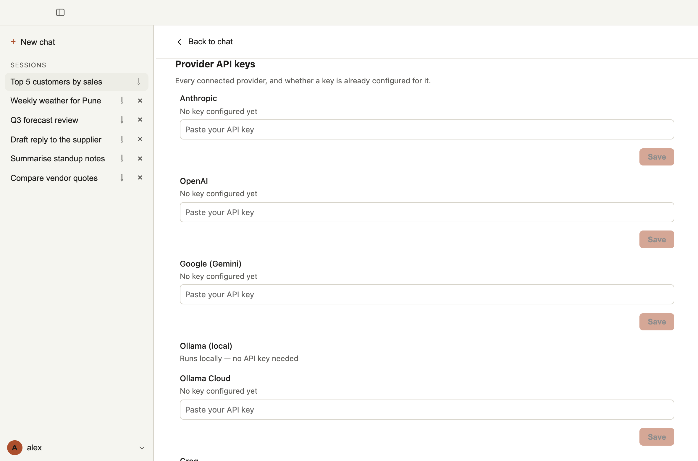
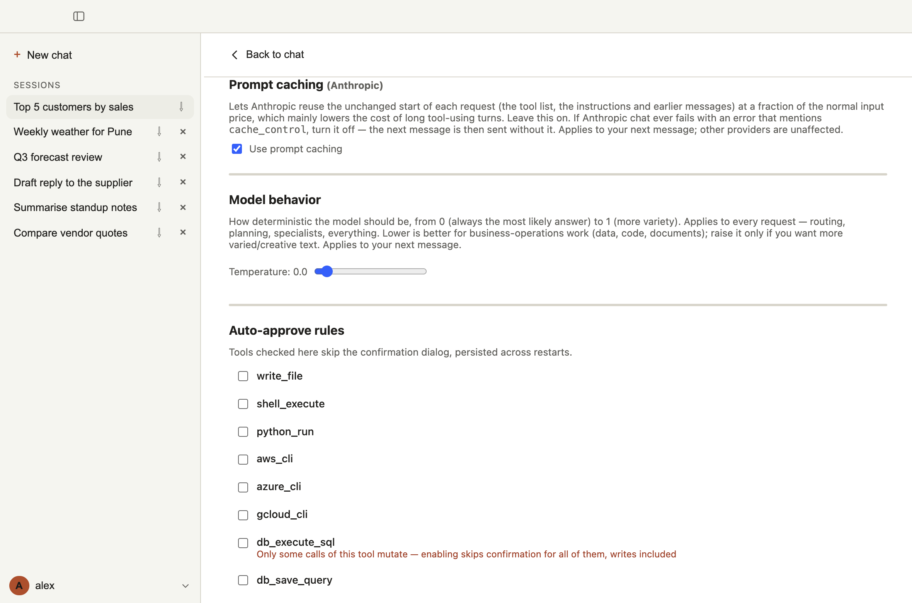

# 3. Providers and keys

Sachivji does not include an AI model of its own. You connect it to a provider, and your messages go to that provider to be answered. You choose the provider and the model, and you can switch at any time, even in the middle of a conversation.

## Supported providers

| Provider | Needs a key | Notes |
|---|---|---|
| **OpenAI** | Yes | The default provider. |
| **Anthropic** | Yes | Claude models. Supports prompt caching (see below). |
| **Google (Gemini)** | Yes | Gemini models. |
| **Groq** | Yes | Hosted open models; free tiers have strict rate limits. |
| **Mistral** | Yes | Mistral models. |
| **Ollama Cloud** | Yes | Models hosted by Ollama. |
| **Ollama (local)** | No | Models running on your own computer through Ollama. **Known limitation:** in the installers, this provider currently talks to the small Ollama server that comes with Sachivji, which only holds the embedding model, so models you installed with your own Ollama are not reachable from the installers yet. It works as described when Sachivji is run from source. |

For hosted providers, create an API key on the provider's own website (in the account's API keys section). Usage is billed by the provider, not by Sachivji.

## Adding a key

1. Open **Settings** (click your name at the lower left, then **Settings**). Or click the provider name in the status bar under the message box if it says a key is missing.
2. Under **Provider API keys**, find the provider, paste the key and click **Save**.
3. Sachivji checks the key with the provider and shows **✓ Key verified**, or **✗ Key rejected** with the reason.

Once a key is saved, only its last few characters are shown, so you can confirm which key is in use. Keys are kept in your operating system's secure storage (or in the plain file, if you chose that at first run). They are never shown again in full.

## Choosing a model

In the chat window, the provider and model name at the right end of the status bar (for example "OpenAI · gpt-4o-mini") opens a small panel. Pick the provider, then pick a model from the list that the provider returns. If a model is not listed, you can type its name.

Which model should you use?

- **Start small.** The smallest commercial models (for example `gpt-4o-mini` or `claude-haiku-5-5`) are usually good enough for everyday tasks and cost little.
- **Step up for hard work.** Larger models (Sonnet, Opus and similar) reason better and handle long, multi-step jobs more reliably, at a higher price.
- **Local models** (Ollama) cost nothing per message and keep everything on your machine, but they are usually weaker and slower, and small ones may ignore instructions or loop. Try a larger local model if results are poor. (See the known limitation in the provider table above for the installers.)

You can try the same task on two models to compare. Changing the model does not lose your conversation.

## Watching cost and context

The status bar shows a meter for the current chat, in the form `ctx used / window · Σ total · cost`.

- **ctx** is how much the latest request held, against the model's *context window*, the amount it can read at once. When it gets close to the limit (about 80%) it turns to a warning. Sachivji trims old tool output and old messages automatically to stay within the limit, without changing what is stored or shown.
- **Σ** is the total tokens sent and received in this chat. It grows faster than ctx, because every step re-sends the conversation.
- **Cost** is an estimate for the current model.

## Settings that affect the model

All of these are in **Settings** and apply to your next message.

- **Model behavior (temperature):** from 0 (always the most likely answer) to 1 (more variety). Low values suit business work such as data, code and documents. Raise it only for more varied or creative text.
- **Plan complex requests before acting** (Orchestrator): for a genuinely multi-part request, Sachivji first builds a step list and then runs it. This adds one extra round-trip per message. Turn it off if your model is slow.
- **Show which model answered each message** (Transcript): useful when you switch models during a conversation. Off by default.
- **Prompt caching (Anthropic):** lets Anthropic reuse the unchanged start of each request at a fraction of the normal price, which lowers the cost of long tool-using turns. Leave it on. If Anthropic chat ever fails with an error mentioning `cache_control`, turn it off.

## Troubleshooting provider problems

- **"Key rejected":** check that you pasted the whole key, with no spaces, and that it belongs to the selected provider.
- **A rate-limit or quota error:** the provider is refusing more requests for now. Wait, switch to another model or provider, or check your plan with the provider. Free tiers are the usual cause.
- **No model is listed:** the provider may need a key first, or your network may be blocking it. You can still type a model name by hand.
- **Ollama (local) is not responding or shows no models:** see the known limitation in the provider table above. In a build run from source, make sure Ollama is running and the model has been pulled.

See also [Settings reference](10-settings-reference.md) (planned) for every option.
