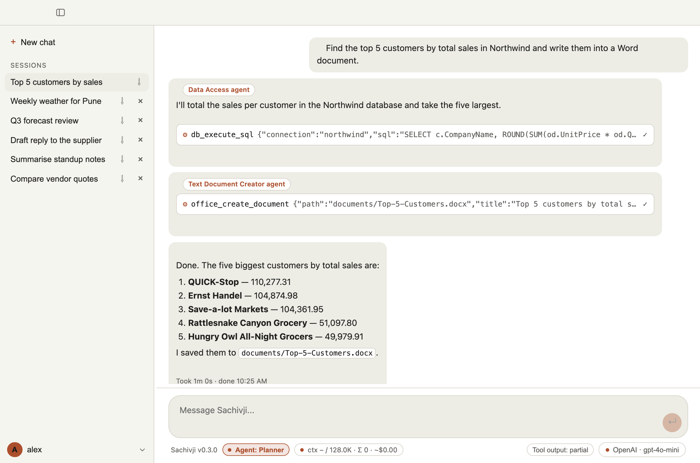

# 5. Agents and roles

Sachivji works as a small team. A **main assistant** talks to you and a set of **specialists** each do one kind of job. You can leave the choice to the assistant, or pick a specialist yourself.

## How the work is shared

When you send a message in **Auto** mode, the main assistant decides what to do:

- It answers directly, or does a simple task itself. In Auto mode it can use any tool of any specialist, because handing off a one-step job would only slow it down.
- Or it **hands the job to a specialist** when the task is big enough to benefit from a focused helper with its own instructions and step budget. You see this on the reply: each part carries a label such as **Data Access agent** or **Text Document Creator agent**, so you always know who did what.
- For a request with several parts, it can first make a **plan**, a short checklist of steps, each given to the right specialist (see [Using the chat](04-using-the-chat.md)).

A specialist reports back to the main assistant, which gives you the result. A specialist's reply is not repeated word for word.

Every specialist is limited to the tools it was given, and every action that changes something still asks for your approval.

## The built-in specialists

| Specialist | What it is for | What it does not do |
|---|---|---|
| **Planner** | Turns a large or vague request into an ordered list of steps. Reasoning only: it has no tools. | It never carries out a step itself. |
| **Researcher** | Researches the web in depth: searches, reads many pages, keeps notes with sources, finds and downloads stock photos, saves findings to a text file. | It does not run code, recall past chats or call your configured APIs. |
| **History Analyst** | Searches your own past conversations by meaning, to recall what was said or decided, or to compare how something changed over time. See [Memory across chats](07-memory-across-chats.md). | It cannot look anything up online. |
| **Developer** | Writes **and runs** code: Python in the workspace environment, shell commands, git, the AWS, Azure and Google Cloud command line tools, and GitHub. "Make a chart and run it" is one job for it. | Not for plain Word documents or database queries. Every command asks for confirmation, and it is not a sandbox. |
| **Data Access** | Queries the databases and calls the external APIs you configured in Settings (listing tables, reading structure, running SQL, saving a good query for reuse). | It needs at least one configured connection. It does not read local files or create connections. |
| **Data Processor** | Works with structured files: CSV, JSON, XML and Excel. Summarises and queries them, appends a record, reads and edits workbooks. | It does not use databases and does not write general code. |
| **Text Document Creator** | Creates Word and other Office documents, fills your templates keeping their styling, turns an existing document into a template, and reads documents. | It cannot edit an existing file in place, and it cannot draw charts from data on its own (that needs a script, so the Developer). |
| **Configurator** | Sets up connections to databases, external APIs and MCP servers from details you give in the chat, testing each one before saving. Passwords and keys go into the confirmation dialog, never into the chat. | It does not use the connections afterwards. |
| **MCP Operator** | Uses the tools of your connected MCP servers (a wiki, a knowledge base, an integration). It is the only specialist that carries those tools. | It needs at least one connected server. Not for the open web or your databases. |
| **Email** | Drafts and sends an email from a short brief using your configured email account. Sending always asks first. | It needs a configured email account. It does not write documents or look up addresses. |
| **Page Creator** | Designs one slide of a presentation from a brief. The main assistant calls it once per slide when you ask for a presentation. | It is not a chat partner: you cannot pick it, and it is never a plan step. |

Data Access, MCP Operator and Email need a configuration to work (a connection, a connected server, an email account). Until it exists, the assistant treats that specialist as unavailable.

For the exact tools each specialist has, see the [Tool catalog](appendix-tool-catalog.md), or **Settings > Tools by role** in the app.

## Letting the assistant choose (Auto)

In Auto mode, describe the result you want and name the data or file. You do not have to say which specialist to use. Good requests name the thing to work on:

- "How many customers are in the Northwind database?" goes to Data Access.
- "Find recent news about renewable energy policy in the EU." goes to the Researcher.
- "Write a Python script that turns this data into bar charts, run it, and put the charts in a Word file." goes to the Developer (and then the Text Document Creator for the file).
- "What did we conclude about the Q3 forecast last week?" goes to the History Analyst.

If the wrong specialist was used, say so and name the one you want, or pin one (below).

## Choosing a specialist yourself

Click the **Agent** button in the status bar. A menu opens upward listing **Auto** and each specialist you can pick, including roles of your own, with the current choice marked; click one to choose it. Esc or a click elsewhere closes the menu, and the arrow keys and Enter work too. Or press **Ctrl+Tab** in the message box (**Ctrl+Shift+Tab** goes backwards) to move to the next choice without opening the menu.

While a specialist is pinned:

- It answers **alone**. It does not hand work to other specialists.
- If you ask it for something that is not its job, it passes the request back to the main assistant, which then handles it in Auto fashion.
- The choice stays until you change it with the menu or Ctrl+Tab.

Pin a specialist when you want a specific behaviour (for example, only the Researcher), or when Auto keeps choosing wrongly for your kind of request. Go back to **Auto** for everyday use.

## Plans

For a request with several parts, the assistant can first build a plan. Each step is assigned to a specialist, and the checklist shows each step as waiting, running, done or failed. You can turn planning off in **Settings > Orchestrator**. See [Using the chat](04-using-the-chat.md).

## Your own specialists

You can add roles of your own: a specialist with your instructions and a short list of tools. They appear next to the built-in ones, in Auto routing and in the Agent selector. See [Your own roles](06-your-own-roles.md).

## Tips

- **Be specific about the input.** Name the database, the file or the connection; the specialists pick tools from that.
- **One job per request works best** for small models. For a long job, ask for a plan first.
- **Use the right size of model.** Specialists inherit your chosen model. A hard multi-step job benefits from a stronger one (see [Providers and keys](03-providers-and-keys.md)).
- **Watch the labels.** If a reply was written by a specialist that surprised you, you can ask the assistant to redo it with the one you meant.
- **Not sure what a specialist does?** Pick it in the Agent selector and send "Hello". It replies with its role, what it can do and its main tools (Sachivji makes sure of this even with a small model; the reply appears all at once). If it does not, ask "What can you do?".
