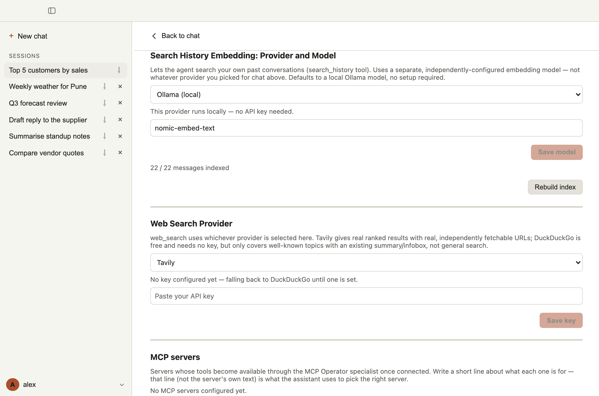

# 7. Memory across chats

Sachivji remembers what happened in your earlier chats and can search it for you. You can ask it to recall a decision, find something you discussed weeks ago, or compare how a number or plan changed from one conversation to the next.

This memory is built on **embeddings and a vector database**, the same technology behind semantic search. Each piece of a conversation is turned into a list of numbers that captures its meaning (an *embedding*), by an embedding model. The numbers are stored in a **vector database** that sits inside the same local database file as your chats (SQLite with the `sqlite-vec` extension), and a question is answered by finding the stored pieces whose meaning is closest to it. Nothing needs to be installed or run separately. The details are in [How it works](#how-it-works).

The memory is a **search over your own past messages**, kept on your computer, and it only knows what was actually said or found in your chats.

## A chat and its context

Two things are easy to confuse:

- **What a chat has.** Every chat keeps its complete history: all messages, results and pictures stay stored for as long as the chat is in the app. Open it at any time, even months later, and carry on. Nothing needs to be restored or reloaded.
- **What the assistant is given for one question.** For each new message, Sachivji builds the context from that history and sends it to the model. The model can read only a limited amount at once (its *context window*), so when a chat is very long, the oldest parts and bulky tool results are trimmed from what is sent. They are still stored and still shown on screen, but the model may not see them for that question. See [Watching cost and context](03-providers-and-keys.md#watching-cost-and-context).

The cross-chat search below fills this gap. It lets the assistant reach into other chats, and into the parts of the current chat that no longer fit in the context. Deleting a chat removes it for good, including from the search.

## What you can ask

Ask in plain language, in any chat:

- **Recall:** "What did we conclude about the Q3 forecast?"
- **Find a reference:** "Which chat was it where we looked at the vendor quotes?"
- **Compare over time (a delta):** "How did the numbers we discussed for the Pune site change between last month and now?"
- **Change since:** "What is different in the supplier's latest quote compared with the one we looked at before?"
- **Pick up where you left off:** "Remind me what we decided about the report layout, and carry on from there."

The **History Analyst** specialist handles these (see [Agents and roles](05-agents-and-roles.md)); in Auto mode the main assistant can also search directly. You can pin the History Analyst with the Agent selector if you want it to answer alone.

The search also covers the **current** chat, so you can ask about something said much earlier in a long conversation that no longer fits in the model's reading window.

## How it works

1. **Every message is indexed as you chat.** A moment after a message is saved, its text is split into short pieces and turned into a numeric fingerprint of its meaning (an *embedding*) by an embedding model. The pieces and their fingerprints are stored in the same local database as your chats.
2. **Existing messages are caught up at startup.** Anything not yet indexed (for example chats from before you set it up) is processed in the background when the app starts.
3. **A search is by meaning, not by exact words.** Your question is turned into a fingerprint too, and the closest pieces of past conversation are returned, each labelled with the **chat title**, the **date** and a relevance score. "Quarterly revenue outlook" can find a chat that said "Q3 forecast".
4. **The assistant reads the excerpts and answers.** It reasons over what it found, for example comparing two excerpts to describe what changed.

What is indexed: the text of your messages and the assistant's replies, and the results of tools (for example the rows a database query returned, or the text of a file it read). Details of how a tool was called are not. The search tool's own earlier results are skipped, so recalling something does not pile up copies.

## Things to know

- **It always returns the closest matches, even when none is really relevant.** A search returns up to 5 excerpts by default (never more than 10), with a relevance score. If you ask about something you never discussed, the assistant may get loosely related excerpts and should say it found nothing solid. Ask it to cite the chat and date if you want to check.
- **Past statements can be out of date.** A note you made last month about a connection or a price may no longer be true. The assistant is told this and should check the current state with a live tool where it can.
- **Deleting a chat removes it from the memory.** The indexed pieces of a deleted chat are deleted with it.
- **It is local by default.** The default embedding model, `nomic-embed-text`, runs on your own computer through the Ollama server that comes with Sachivji. If you choose a cloud embedding provider instead, the text pieces are sent to that provider to compute their fingerprints, so only do that if you are comfortable with the provider seeing your chat text.

## Setting it up

The first-run screens download the embedding model (about 274 MB, once). Nothing else is needed for the default.

Open **Settings > Search History Embedding** to see and change it:

- **Provider and model:** the embedding model that creates the fingerprints. The default is Ollama (local) with `nomic-embed-text`. You can pick another provider (it needs its own key) and model, then click **Save model**.
- **Status line:** shows how many messages are indexed, for example "22 / 22 messages indexed". If search is unavailable it says why (for example, the embedding model has not been downloaded yet).
- **Rebuild index:** indexes everything again from scratch. Use it after changing the model, or if the status shows a problem that you have fixed. **It takes some time.** How long depends on the embedding model you chose (a cloud provider or a larger model can be faster or slower than the small local default, depending on your connection and your computer) and on how much chat history you have: a few chats finish in moments, but years of long chats can take many minutes. The button reads **Rebuilding...** while it works. Keep Sachivji open and wait until it finishes and the status line shows all messages indexed. Search may be incomplete until then.

**Changing the model needs a rebuild.** Fingerprints from different models cannot be compared, so after you change the provider or model, Settings shows that the index needs a rebuild, and search is off until you click **Rebuild index**.

## When it does not work

| What you see | What it means and what to do |
|---|---|
| "Search history disabled — …model not found" | The embedding model has not been downloaded. Check **Settings > Local embeddings** (see [Install and first run](02-install-and-first-run.md)), fix it, then click **Rebuild index**. |
| "Embedding model changed — index needs a rebuild" | You changed the provider or model. Click **Rebuild index**. |
| "The embedding model was updated or reinstalled since the index was built…" | The model kept its name but its contents changed (for example after reinstalling Sachivji or updating Ollama), so old and new fingerprints cannot be compared. Click **Rebuild index**. Until then no new messages are added to the index and the assistant tells you the index needs a rebuild. |
| "0 / 0 messages indexed" on a fresh install | Nothing has been indexed yet. Send a message, or wait a moment for the startup catch-up. |
| The assistant says the history is not available | The embedding service could not be reached. Check Settings, and your network if you use a cloud provider. |
| Results look unrelated | There may be nothing relevant in your history. Ask a narrower question, or name the topic and roughly when you discussed it. |

## What is not available yet

- There is no search box for your list of chats. You search your history by asking the assistant. A text search over the chat list and a find-in-chat shortcut are planned.
