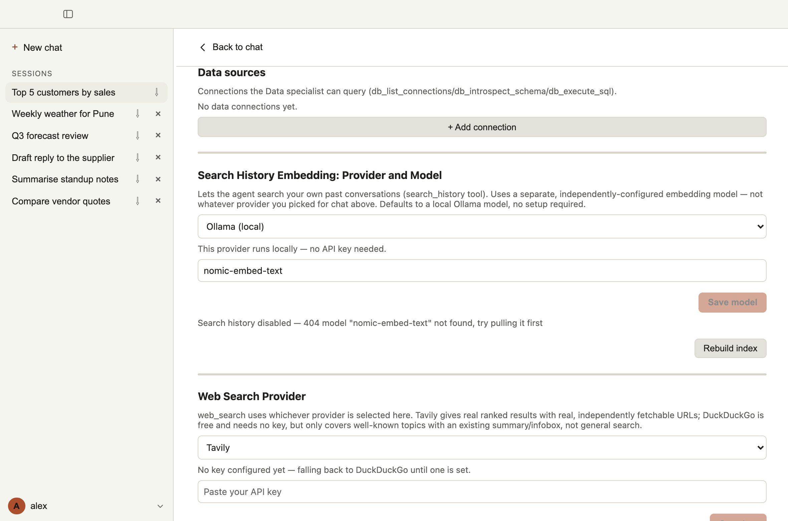
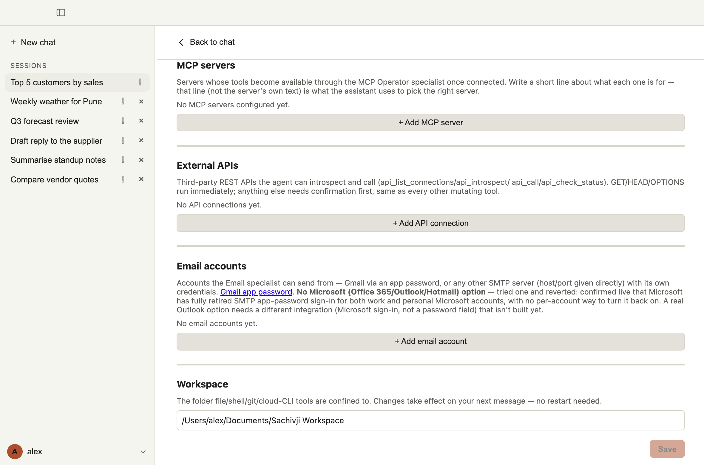

# 9. Connecting data and services

Sachivji can work with your databases, web services, MCP servers and email accounts once you connect them. There are two ways to connect each one:

1. **Ask the assistant.** Describe what you want ("Connect Sachivji to our Postgres reporting database"). The **Configurator** specialist gathers the details, tests the connection for real before saving it, and asks you to type any password or key into the **confirmation dialog**, never into the chat.
2. **Use Settings.** Each kind has a section in **Settings** with an **+ Add** button and a form. You can also edit or remove a connection there.

Either way, secrets (passwords, tokens, keys) are stored in your operating system's secure storage, or in the file you chose at first run. They are never shown again in full and never sent to the model.

After a connection exists, the matching specialist can use it: **Data Access** for databases and APIs, the **MCP Operator** for MCP servers, **Email** for email accounts.

## Databases

**Settings > Data sources.** Supported engines: **SQLite**, **Postgres**, **SQL Server** and **MySQL**.

> **More databases are planned.** Support for more database engines is planned for the next version. If you need a specific database, reach out to the development team and tell them which one. *[Support contact to be added when the support system is in place.]*

| Field | Meaning |
|---|---|
| Connection name | The name you and the assistant use for it (for example `northwind`). |
| Engine | SQLite, Postgres, SQL Server or MySQL. |
| Path to .db file | SQLite only: the path of the database file. |
| Host, Port, Database | Other engines: where the server is and which database to use. |
| Username, Password | Other engines: the account to use. A read-only account is a good idea. |

When editing, leave the password blank to keep the current one.

### Asking questions of a database

Name the connection and ask in plain words:

- "How many customers are there in the Northwind database?"
- "Show the top 10 customers by sales for each year."
- "Which tables hold order data, and how are they related?"

The assistant lists the connection, reads its tables and columns, and writes the query. **SQL that only reads runs freely. SQL that changes data asks for your approval first**, and you can edit it before approving. When a question works well, the assistant can **save the query** as a reusable tool, so a similar question next time is answered directly.

For simple lookups it can list rows, count them or find rows where a column has a value, without writing SQL. A worked example (creating and connecting a SQLite database) is below.

## External web services (REST APIs)

**Settings > External APIs.** Connect any REST API, for example a weather service.

| Field | Meaning |
|---|---|
| Connection name, Base URL | The name, and the API's base address, for example `https://api.example.com/v1`. |
| Authentication | **No auth**, **API key**, **Bearer token** or **Basic auth**. |
| API key placement | For an API key: send it in a **header** (give the header name, for example `X-API-Key`) or as a **query parameter** (give the parameter name). |
| OpenAPI/Swagger spec URL | Optional. If given, the assistant can discover the API's endpoints from it. |

What the assistant can do with a connected API: discover its endpoints, make authenticated calls (a call that changes something asks first), follow paginated results when asked, and check on a long-running job started by an earlier call.

**Limit today:** a connection holds one fixed credential (a key, a token or a user name and password) that is sent with every call. Some services need more than that, for example an API key to log in, which returns a **session token** that must then be used for the following calls and may expire. These are not set up automatically yet. We plan to enhance this part so that Sachivji inspects the service itself and configures the connection, including its authentication steps. Until then, such a service may need a long-lived token if the provider offers one, or help from the development team. *[Support contact to be added when the support system is in place.]*

### Example: Open-Meteo weather

Open-Meteo is a free weather service that needs no account or key, so it is a good first API to try. Connect it in **Settings > External APIs > + Add connection**:

| Field | Value |
|---|---|
| Connection name | `open-meteo` |
| Base URL | `https://api.open-meteo.com` |
| Authentication | **No auth** |
| OpenAPI/Swagger spec URL | leave empty |

Then ask in the chat, for example:

> Using the open-meteo connection, show me the weather forecast for Pune for this week.

The assistant works out the coordinates of Pune, makes the API call and answers with a table like this (the values are a real Open-Meteo forecast fetched on 15 October 2026; yours will differ):

| Date | High (°C) | Low (°C) | Rain (mm) |
|---|---|---|---|
| 2026-10-15 | 33.0 | 22.5 | 0.00 |
| 2026-10-16 | 33.4 | 21.9 | 0.00 |
| 2026-10-17 | 33.7 | 22.0 | 0.00 |
| 2026-10-18 | 33.6 | 22.7 | 0.00 |
| 2026-10-19 | 33.8 | 23.5 | 0.00 |
| 2026-10-20 | 34.2 | 23.8 | 0.00 |
| 2026-10-21 | 33.9 | 23.3 | 0.00 |

You can go on from there: "Draw these as a chart" (see [Charts, scripts and data analysis](08-working-with-files-and-documents.md#charts-scripts-and-data-analysis)) or "Draw these as Mermaid charts" (see [Diagrams](08-working-with-files-and-documents.md#diagrams)). The full walk-through, with the other questions to try, is in [Example 2](#example-2-a-web-api-open-meteo-weather) at the end of this page.

## MCP servers

MCP (Model Context Protocol) servers add tools from outside: a wiki, a knowledge base, a documentation service, an integration. **Settings > MCP servers.**

| Field | Meaning |
|---|---|
| Server name | A short name. |
| **What is this server for?** | A one-line description, up to 200 characters. **Write it carefully**: this line, not the server's own text, is what the assistant uses to decide when to use the server. |
| Type | **Local (stdio)**: a program on your computer. Give the command (for example `npx`), its arguments and optional environment variables. **Remote (HTTP)**: a server at a web address, with an optional bearer token. |

Things to know:

- Sachivji includes Node.js, so servers started with `npx` work without installing Node yourself.
- If a server cannot start, its status line shows what the program printed and the likely cause (wrong file path, program not installed, missing packages); see [Troubleshooting](12-troubleshooting.md).
- Tools a server declares read-only never ask for confirmation, so they have no row in Settings > Auto-approve rules.
- Each connected server's tools belong to the **MCP Operator** specialist only. A server with many tools therefore adds nothing to other requests.
- Text that comes from a server (its tool descriptions) is treated as untrusted third-party text and is shortened.
- A server that stops working shows its error; use **Reconnect** to try again.

A worked example (the Context7 documentation server) is below.

## Email accounts

**Settings > Email accounts.** The **Email** specialist sends from these accounts.

| Field | Meaning |
|---|---|
| Display name | For example "Work Gmail". |
| Provider | **Gmail** (uses an *app password*, not your normal password) or **Custom SMTP server**. |
| Email address, Password / app password | The account. For Gmail, create an app password in your Google account's security settings. |
| SMTP host, Port, TLS | Custom servers only: for example port 587 uses STARTTLS and port 465 uses TLS on connect. |

You can set one account as the **default**. **Sending always asks for your approval**, and shows the message first.

> **For now, use Gmail.** Gmail is the account type we recommend and support at this time, because it is the easiest to set up: you create an *app password* in your Google account (Google offers app passwords once 2-Step Verification is switched on), and paste it into Sachivji. Other providers, such as Outlook or Microsoft 365, usually need **OAuth 2** sign-in and other settings that are specific to each provider, and we will handle those case by case. A **Custom SMTP server** can work for a provider that accepts a plain user name and password, but it is not part of the tested set. If you need a specific provider, reach out to the development team. *[Support contact to be added when the support system is in place.]*

A worked example (a Gmail account) is below.

## Web search

**Settings > Web Search Provider.** The Researcher's web search uses **Tavily** when you give it a key (real ranked results; a free account is enough to start) and otherwise falls back to **DuckDuckGo**, which only covers well-known topics. The Settings screen says which one is in use.

## Searching your past chats

The embedding model that powers memory across chats is set in **Settings > Search History Embedding**. See [Memory across chats](07-memory-across-chats.md).

## Worked examples

Four examples, one for each kind, that you can follow exactly. The first three show the quick way (ask the assistant) and what to enter in Settings if you prefer the form. Email accounts are added in Settings only.

### Example 1: a database (create a SQLite file and connect to it)

SQLite needs no server: a database is a single file. This example makes a small shop database and connects to it.

**Step 1. Create the database by asking.** Type:

> Create a small SQLite database at `data/shop.db` using Python. Add a `customers` table with 10 made-up customers (name, city) and an `orders` table with 30 made-up orders (customer, order date, amount). Tell me when it is done.

The assistant (the Developer) writes a short Python script and asks to run it. Read it, then click **Approve**. The file appears in `data/shop.db` inside your workspace (the full path is shown in **Settings > Workspace**).

**Step 2. Connect to it.** Either ask:

> Connect Sachivji to the database at `data/shop.db` and call the connection `shop`.

The Configurator tests the connection and shows a confirmation; click **Approve**. Or use **Settings > Data sources > + Add connection**: name `shop`, engine **SQLite**, and the **full path** of `shop.db` in *Path to .db file* (a relative path is not reliable here), then **Save**.

**Step 3. Ask questions.**

> Which customers placed the most orders?
> Show the total order value for each month.
> Save that last query so I can ask it again later.

Reading questions run without asking. The assistant shows what it ran. If you ask it to change data (for example "add a new customer"), it asks for your approval first and shows the SQL.

If you later want a larger sample to try, the project's `scripts/generate_sample_db.py` builds a wind and solar database of about 1 GB; you do not need it for this example.

### Example 2: a web API (Open-Meteo weather)

Open-Meteo is a free weather service that needs no account or key (free for non-commercial use; check their terms for anything else).

**Connect it.** Either ask:

> Search for a free weather information API and configure it in our app.

or use **Settings > External APIs > + Add connection**:

| Field | Value |
|---|---|
| Connection name | `open-meteo` |
| Base URL | `https://api.open-meteo.com` |
| Authentication | **No auth** |
| OpenAPI/Swagger spec URL | leave empty |

**Use it.**

> Show me the weekly weather for Pune for this week.
> What can the Open-Meteo API do?
> Create a chart of Pune's weekly weather.

The first question makes the assistant call the API (it works out the place's coordinates itself). The second makes it read the API's own description. The third needs the Developer to draw a chart, so you will be asked to approve a script run.

Tip: in a **new** chat, a request such as "weather in Pune" may be answered with a web search instead of your connection. Say "using the open-meteo connection" to make it use the API.

### Example 3: an MCP server (Context7 documentation)

Context7 is an MCP server that fetches up-to-date documentation for programming libraries. It connected without any key or account when we tested it.

**Connect it.** Either ask:

> Search for how to set up the Context7 MCP server and configure it in our app.

or use **Settings > MCP servers > + Add MCP server** with one of these two setups:

| | Local (stdio) | Remote (HTTP) |
|---|---|---|
| Server name | `context7` | `context7` |
| What is it for? | `Up-to-date documentation and code examples for programming libraries` | the same |
| Type | **Local (stdio)** | **Remote (HTTP)** |
| Command, Args | `npx` and `-y @upstash/context7-mcp` | not used |
| Server URL | not used | `https://mcp.context7.com/mcp` |

The local setup needs a network connection the first time (it downloads the server with the Node that comes with Sachivji). Either way, the server shows as connected in the list. If it shows an error, click **Reconnect**.

**Use it.**

> Using Context7, show me how to read a CSV file with the pandas library.
> What can the Context7 server do? List its tools.
> Using Context7, find documentation on AppleScript.

Name the server in your request ("using Context7") so the assistant knows to use it instead of searching the web. The **MCP Operator** specialist does the work. Because you wrote a clear one-line description, the assistant also picks the server by itself when a question is about library documentation.

### Example 4: an email account (Gmail)

You will add a Gmail account, then ask the assistant to send a test message to yourself. Unlike a database or a web API, the assistant cannot create an email account for you. You add it in **Settings**.

**1. Create an app password in Google.** An app password is a 16-character password that Google makes for one app, so Sachivji never sees your real Gmail password. You need your Google account open in a browser.

1. **Switch on 2-Step Verification** if it is not on yet: <https://myaccount.google.com/signinoptions/two-step-verification> (Google's instructions: <https://support.google.com/accounts/answer/185839>).
2. **Create the app password** at <https://myaccount.google.com/apppasswords> (Google's instructions: <https://support.google.com/accounts/answer/185833>). Sign in if asked, name it "Sachivji" and create it.
3. **Copy the password** Google shows. It appears as four groups of four letters, and you see it only once.

Google says you may not see the app password option if 2-Step Verification is set up with security keys only, if you are signed in to a **work, school or other organisation account**, or if the account uses Google's **Advanced Protection**. Such an account cannot be used with Sachivji. Also, **when you change your Google account password, Google revokes your app passwords**, so Sachivji's sign-in will start failing and you must create a new one.

> **These links can change.** They were checked on 2026-10-16. Google owns these pages and may move, rename or remove them whenever it likes, so they are not permanent. If a link does not work, search the Google Account Help for "app passwords" or "2-Step Verification".

**2. Add the account in Sachivji.** Open **Settings > Email accounts**, click **+ Add email account** and fill in:

| Field | What to enter |
|---|---|
| Display name | `My Gmail` (any name you will recognise) |
| Provider | **Gmail** |
| Email address | Your full Gmail address |
| Password / app password | The app password from step 1 |

Click **Add account**. The button says "Signing in..." for a moment while Sachivji checks the password with Gmail. **No message is sent during this check.** If the sign-in works, the account appears in the list. If it fails, the form shows Google's message and nothing is saved.

If you add only one account, it is the default automatically. With more than one, click **Set as default** next to the one to use when you do not name an account.

**3. Send a test message.** In a chat, ask:

> Send an email to my own address saying "Hello from Sachivji", with the subject "Test".

The **Email** specialist prepares the message and Sachivji shows a confirmation with the account it will send from, the recipients, the subject and any attachments. **Nothing is sent until you approve.** After you approve, check your inbox.

To send a file, name it in your request, for example "email report.docx to ..." The file must be in your workspace.

**If something goes wrong**

- **A sign-in error mentioning an "application-specific password":** you entered your normal Gmail password, or 2-Step Verification is off. Create an app password and use that.
- **It worked before and now fails:** you probably changed your Google password, which revokes every app password. Create a new one and edit the account in Settings.
- **"Username and Password not accepted":** check the address, and create a fresh app password. If you pasted it with spaces, try it without them.
- **The assistant says the message was sent but it did not arrive:** look in the recipient's spam folder, and in the **Sent** folder of your Gmail account.

**To remove access.** Click **Remove** next to the account in Settings. That deletes the stored password from your computer. To make the app password useless everywhere, also remove it in your Google account's app password list (<https://myaccount.google.com/apppasswords>, then **Remove** next to the app).

## Tips and safety

- **Prefer a read-only database account** for anything you only want to query.
- **Write good one-line descriptions** for MCP servers, and keep the list short.
- **You are always asked before a connection is created or a change is made.** If a connection test fails, the assistant reports why and does not save it.
- To remove access, remove the connection in Settings.
