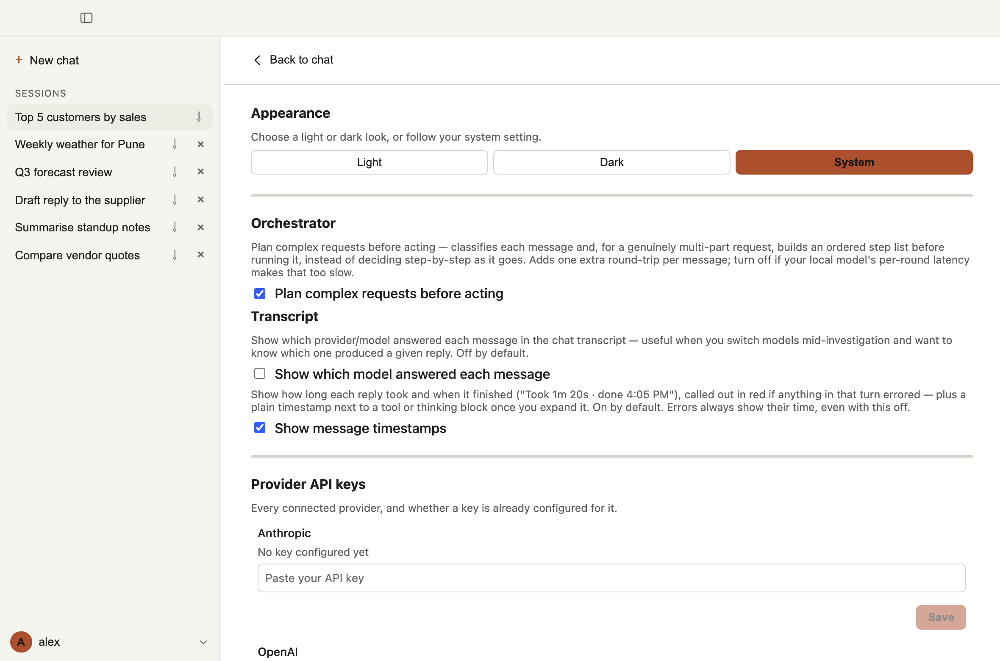
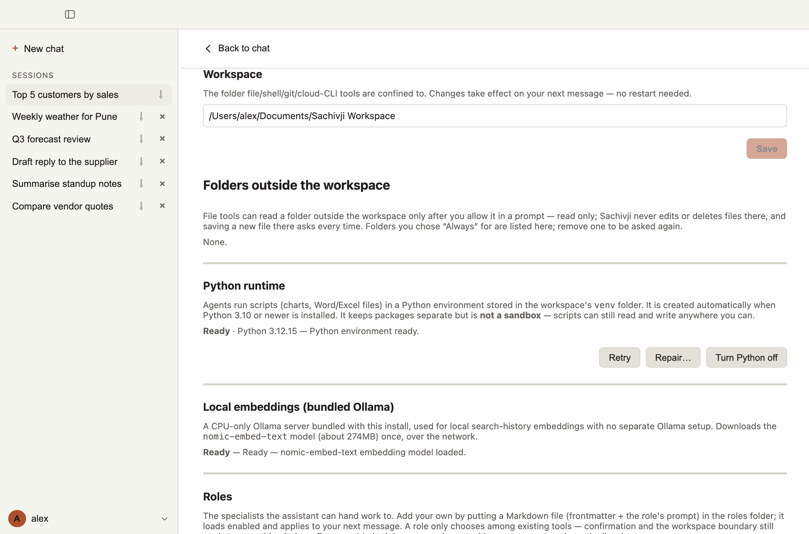
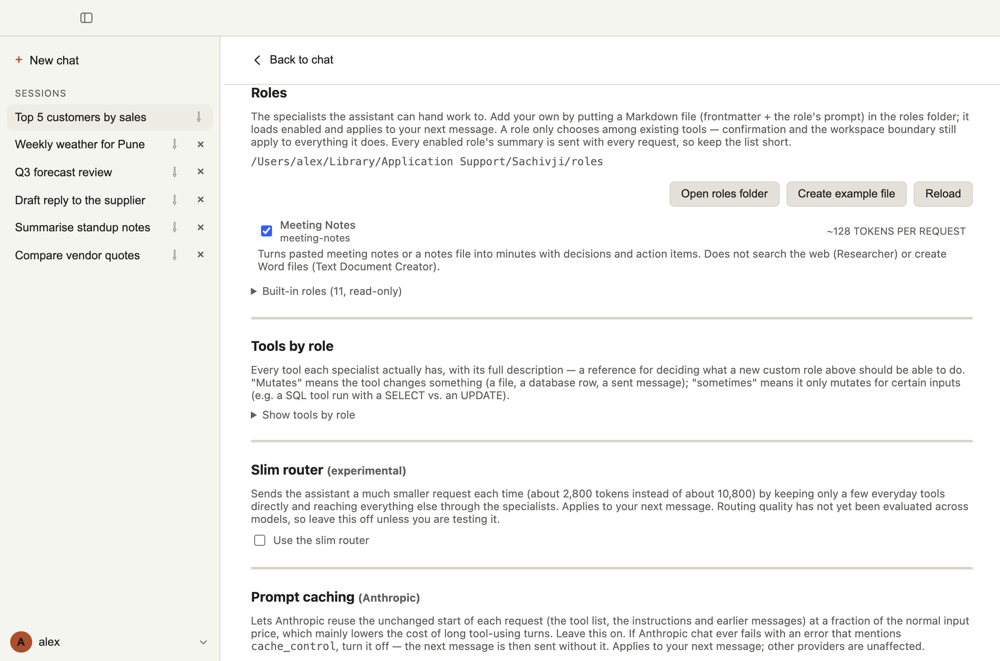

# 10. Settings reference

Open Settings from the menu at your name in the lower left, then **Settings**. The sections are listed here in the order they appear. Most changes apply to your **next message**, with no restart.

| Section | What it controls | Default |
|---|---|---|
| Appearance | Light, dark or system theme | System |
| Orchestrator | Plan complex requests before acting | On |
| Transcript | Show the answering model; show message timestamps | Model off, timestamps on |
| Provider API keys | One key per provider | None |
| Data sources | Database connections | None |
| Search History Embedding | The embedding model for memory across chats | Ollama (local), `nomic-embed-text` |
| Web Search Provider | Tavily or DuckDuckGo | Tavily (falls back to DuckDuckGo without a key) |
| MCP servers | MCP server connections | None |
| External APIs | Web service connections | None |
| Email accounts | Accounts the assistant can send from | None |
| Workspace | The workspace folder; folders outside it that you allowed | Documents/Sachivji Workspace |
| Python runtime | The Python environment for scripts | Ready after first run |
| Local embeddings (bundled Ollama) | The local embedding server | Ready after first run |
| Roles | Your own specialist roles | None |
| Tools by role | Reference: every tool each specialist has | (read-only) |
| Slim router (experimental) | A smaller request for the main assistant | Off |
| Prompt caching (Anthropic) | Cheaper repeated requests on Anthropic | On |
| Model behavior | Temperature | 0.2 |
| Auto-approve rules | Tools that skip the confirmation | None |
| Secret storage | Where keys and passwords are kept | OS Keychain |

The account menu also has **Export Settings…**, **Import Settings…** and **About** (see the end of this page).

## Appearance

Choose **Light**, **Dark** or **System**. System follows your computer's setting and changes live when it does.

## Orchestrator

**Plan complex requests before acting.** When on, each message is classified first, and a genuinely multi-part request gets an ordered step list that runs step by step (see [Using the chat](04-using-the-chat.md)). It adds one extra model round-trip per message. Turn it off if your model is slow.

## Transcript

- **Show which model answered each message.** Useful when you switch models mid-conversation. Off by default.
- **Show message timestamps.** Shows how long each reply took and when it finished ("Took 1m 20s · done 4:05 PM"), in red if anything in that turn errored, and a plain timestamp beside a tool or reasoning block once you expand it. On by default. Errors always show their time.

## Provider API keys

Every provider, with its key status. Paste a key and click **Save**; Sachivji checks it with the provider. Ollama (local) needs no key. See [Providers and keys](03-providers-and-keys.md).

## Data sources, External APIs, MCP servers, Email accounts

Add, edit or remove connections. Fields and examples are in [Connecting data and services](09-connecting-data-and-services.md). Leave a password or token blank when editing to keep the stored one.

## Search History Embedding and Local embeddings

The embedding provider and model for memory across chats, the index status, **Save model** and **Rebuild index**, and the status of the bundled Ollama server and its model. See [Memory across chats](07-memory-across-chats.md).

## Web Search Provider

Choose **Tavily** (paste its key; a free account gives a monthly allowance of searches) or **DuckDuckGo** (free, no key, but only for well-known topics). Without a Tavily key, Sachivji falls back to DuckDuckGo and says so on this screen.

## Workspace

- **Workspace folder.** The folder that file, shell, git and cloud-CLI tools are confined to. Type or paste a path and click **Save**.
- **Folders outside the workspace.** Folders you allowed with *Always* in the confirmation. Remove one to be asked again. Access is read-only. See [Working with files and documents](08-working-with-files-and-documents.md).

## Python runtime

The Python environment, stored in the workspace's `venv` folder, that scripts run in. It shows the state (for example **Ready · Python 3.12**) and three buttons:

- **Retry**: tries the setup again.
- **Repair…**: rebuilds the environment (for example when it is older than the app expects).
- **Turn Python off**: the assistant works without running code; **Turn Python on** brings it back.

## Roles

Your own specialist roles. **Open roles folder**, **Create example file**, **Reload**, a checkbox per role to switch it off, problems and warnings for each file, and the token cost of each role per request. See [Your own roles](06-your-own-roles.md).

## Tools by role

A read-only reference: every tool each specialist actually has, with its full description, and whether it changes things ("always", "sometimes", "never"). Use it to choose tools for a role of your own. See also the [Tool catalog](appendix-tool-catalog.md).

## Slim router (experimental)

Sends the main assistant a much smaller request each time (about 2,800 tokens instead of about 10,800) by keeping only a few everyday tools and reaching everything else through the specialists. How well it routes has not yet been measured across models, so **leave it off** unless you are testing it.

## Prompt caching (Anthropic)

Lets Anthropic reuse the unchanged start of each request at a fraction of the normal price. Leave it on. If Anthropic chat ever fails with an error that mentions `cache_control`, turn it off. Other providers are unaffected.

## Model behavior

**Temperature**, from 0 (always the most likely answer) to 1 (more variety), applied to every request. Lower is better for data, code and documents. Default 0.2.

## Auto-approve rules

Tools you tick here skip the confirmation dialog, and the choice is remembered. You can also switch these on from the confirmation panel itself ("Always auto-approve"). Be selective: an auto-approved tool can change files or send messages without asking.

**What the list shows.** Every tool that can change something, one row each, with a tag saying where it comes from:

- **Built-in** tools of the application (for example `write_file`, `shell_execute`, `db_execute_sql`, `api_call`).
- **Saved query**: a database query you asked the assistant to save (`db_query_…`).
- **MCP server: name**: one row for each tool of a connected MCP server, named `mcp__server__tool` (two underscores each side). A server with many tools therefore gives many rows. A tool the server did not mark read-only counts as one that changes things.

The list is read when you open Settings, and again when the servers or connections on that screen change; **Refresh list** reads it again by hand (for example after the assistant saved a query).

**Read the red notes.** A tool that only sometimes changes things (SQL, an API call, `git_exec`) is approved for **all** its calls, including those that write or delete. The rule is per tool, not per connection: ticking `db_execute_sql` covers every database you have connected, and `api_call` every API connection. Folder access outside the workspace is never auto-approved, not by a rule and not by the session setting.

**Saved rules for tools that are not available now.** A rule can name a tool that does not exist at the moment: an MCP server you removed or renamed, or one that is disconnected right now. The rule stays stored and is listed in its own section, where you can **Remove** it. It applies again if the server comes back under the same name.

## Secret storage

Shows where provider keys and connection secrets are kept: **OS Keychain** (encrypted by your operating system) or **File** (a plain file). If you are on the Keychain, you can move to the file here, but this moves every secret into a plaintext file, **cannot be undone**, and the Keychain keeps a backup copy.

## Export Settings and Import Settings

In the account menu. They move your configuration to another computer or share it. The Save dialog opens in the workspace's `exports/` folder by default.

**Export Settings…** writes a file with:

- the selected provider and the model chosen for each provider;
- MCP servers, database connections (with their saved queries), external API connections and email accounts, **without any password, key or token**;
- your preferences (theme, temperature, planning, tool output, timestamps, zoom, embedding model, and so on);
- your auto-approve rules;
- your own role files.

**Import Settings…** reads such a file and first shows a **preview**: for each item, whether it will be imported or skipped because one with that name already exists (an existing item is never overwritten). A note beside an item tells you what you still have to do, for example "needs its password entered in Settings", or that an auto-approve rule "runs without asking". Click **Import** to apply. Zoom applies after a restart.

Window sizes and positions are not exported, and secrets never are.

## About

Shows the app name, version, and platform details.
